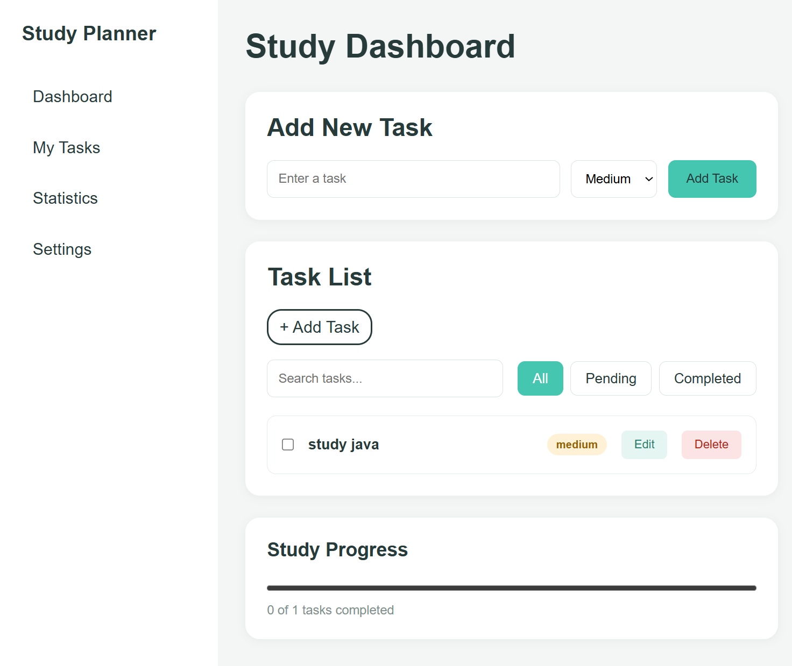
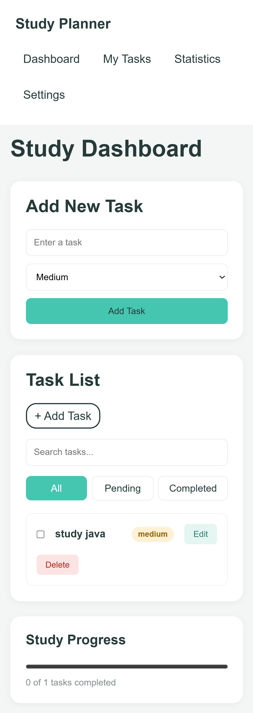

# Study Planner

A responsive study task management web application that helps students organize their study tasks, track priorities, and monitor their progress.

## Features

- Add new study tasks.
- Set task priorities: High, Medium, and Low.
- Mark tasks as completed or pending.
- Edit and delete tasks.
- Search tasks by title.
- Filter tasks by status: All, Pending, and Completed.
- Track study progress with a progress bar.
- Save tasks using LocalStorage, so data remains available after refreshing the page.
- Responsive layout for desktop and mobile screens.

## Technologies

- HTML5
- CSS3
- JavaScript (ES6+)
- Browser LocalStorage

## Project Structure

```text
Study-Planner/
├── index.html
├── css/
│   └── style.css
└── js/
|    └── app.js
|___ screenshots/
      └──desktop.png
      └──mobile.png
```

## Screenshots

### Desktop View


### Mobile View



## How to Run

1. Clone or download this repository.
2. Open the project folder.
3. Open `index.html` in your web browser.
4. Start adding and managing your study tasks.

## What I Learned

- Building responsive layouts using CSS Flexbox and media queries.
- Manipulating the DOM with JavaScript.
- Handling user events.
- Working with arrays and objects.
- Implementing search and filtering functionality.
- Saving and retrieving data using LocalStorage.

## Future Improvements

- Add task deadlines.
- Improve task editing with a custom modal.
- Add dark mode.
